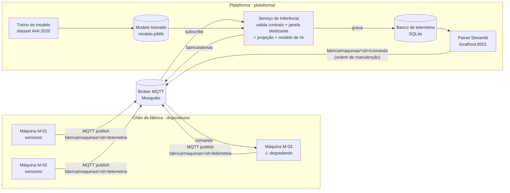

# 🏭 Manutenção Preditiva Industrial com IoT e IA

Sistema que usa dados de sensores de máquinas industriais para **prever falhas antes que aconteçam**, permitindo que a manutenção seja feita no momento certo e evitando paradas não planejadas.

> Projeto final da disciplina **Internet das Coisas e Aplicações de IA e Big Data**, com a sinergia **IoT + Big Data + IA** aplicada à **Indústria 4.0**.

---

## 1. O problema

Parada de máquina não planejada é um dos maiores custos da indústria: a linha para, a produção atrasa e o conserto emergencial custa mais caro. Os dois modelos tradicionais de manutenção são ruins:

| Estratégia | Como funciona | Problema |
|---|---|---|
| **Corretiva** | conserta depois que quebra | parada inesperada, dano maior |
| **Preventiva (por calendário)** | troca peças em intervalos fixos | troca peças ainda boas, e não evita falhas fora do calendário |
| **Preditiva** (este projeto) | monitora a condição real da máquina e age **antes** da falha | ✅ |

## 2. A solução

Cada máquina tem sensores de **temperatura do ar**, **temperatura do processo**, **rotação**, **torque** e **desgaste da ferramenta**. Os sensores publicam a telemetria continuamente via **MQTT**. Um serviço consome esse fluxo em tempo real e, para cada leitura, um modelo de **IA** estima a probabilidade de falha. Quando o risco passa de um limiar, o sistema dispara um **alerta de manutenção** no painel, já indicando a **causa provável**.

| Pilar | Onde aparece no projeto |
|---|---|
| **IoT** | dispositivos (simulados) publicando telemetria via MQTT; comandos de volta para a máquina (manutenção) |
| **Big Data** | ingestão contínua do fluxo de várias máquinas, processamento de stream em **micro-lotes**, **janelas deslizantes** (tendência de cada sensor) e armazenamento em série temporal |
| **IA** | Random Forest treinado com dados históricos (AI4I 2020): probabilidade de falha + classificação do tipo de falha |

## 3. Arquitetura

O repositório segue a divisão real de um sistema IoT: o **chão de fábrica** (`dispositivos/`) e a **plataforma** (`plataforma/`) são projetos independentes, com imagens Docker e dependências próprias. Eles não compartilham código, só o **contrato** de comunicação (`contrato/`): tópicos MQTT + JSON Schemas.



### Componentes

| Lado | Componente | Arquivo | Papel |
|---|---|---|---|
| Chão de fábrica | Mock dos dispositivos IoT | [`dispositivos/simulador/simulador.py`](dispositivos/simulador/simulador.py) | o "firmware": lê sensores, publica telemetria/eventos, executa comandos |
| Chão de fábrica | Física da máquina | [`dispositivos/simulador/maquina.py`](dispositivos/simulador/maquina.py) | como a máquina se comporta, degrada e quebra (a plataforma **não** vê isso) |
| Contrato | Tópicos + JSON Schemas | [`contrato/`](contrato/README.md) | o único acoplamento entre os dois lados |
| Rede | Broker MQTT | [`mosquitto/mosquitto.conf`](mosquitto/mosquitto.conf) | Eclipse Mosquitto |
| Plataforma | Treino da IA | [`plataforma/treino/treinar_modelo.py`](plataforma/treino/treinar_modelo.py) | treina os modelos e salva métricas em `modelos/metricas.json` |
| Plataforma | Ingestão + inferência | [`plataforma/inferencia/servico.py`](plataforma/inferencia/servico.py) | valida as mensagens, calcula o risco, grava no banco, dispara alertas |
| Plataforma | Features | [`plataforma/comum/features.py`](plataforma/comum/features.py) | engenharia de atributos (igual no treino e na inferência) |
| Plataforma | Armazenamento | [`plataforma/comum/armazenamento.py`](plataforma/comum/armazenamento.py) | SQLite (isolado para poder trocar por InfluxDB/TimescaleDB) |
| Plataforma | Painel | [`plataforma/painel/app.py`](plataforma/painel/app.py) | monitoramento ao vivo, alertas, botão de manutenção e validação |

### Contrato: tópicos MQTT

Detalhes e schemas em [`contrato/README.md`](contrato/README.md). A plataforma valida toda mensagem recebida e descarta o que estiver fora do contrato.

| Tópico | Direção | Conteúdo |
|---|---|---|
| `fabrica/maquinas/<id>/telemetria` | máquina → plataforma | leitura dos sensores |
| `fabrica/maquinas/<id>/evento` | máquina → plataforma | `falha` (com o modo) ou `manutencao` (`preventiva`/`corretiva`) |
| `fabrica/maquinas/<id>/comando` | plataforma → máquina | `{"acao": "manutencao"}` |
| `fabrica/alertas` | plataforma → quem assinar | alerta da IA (risco + causa provável) |

Exemplo de telemetria:

```json
{
  "maquina_id": "M-03",
  "ts": 1764000000.12,
  "tipo": "L",
  "temp_ar_k": 300.4,
  "temp_processo_k": 310.5,
  "rotacao_rpm": 1302.7,
  "torque_nm": 55.21,
  "desgaste_min": 160.0
}
```

## 4. O dispositivo simulado (mock)

Como não temos uma fábrica real, o projeto [`dispositivos/simulador/`](dispositivos/simulador/) faz o papel do hardware. Ele é um projeto à parte, com imagem Docker e dependências próprias (só `paho-mqtt` e `numpy`), e **não importa nada da plataforma**.

**Um container por máquina.** Cada máquina roda no seu próprio container, como um microcontrolador (ex.: ESP32) instalado em cada equipamento. A imagem é a mesma (o "firmware"), mas cada uma tem identidade própria (`MAQUINA_ID`), sua própria conexão MQTT e assina só os comandos endereçados a ela. Assim, uma máquina pode cair sem afetar as outras:

| Container | Máquina | Tipo de produto | Comportamento |
|---|---|---|---|
| `maquina-m01` | M-01 | M | saudável |
| `maquina-m02` | M-02 | L | saudável |
| `maquina-m03` | M-03 | L | **degrada até falhar** |
| `maquina-m04` | M-04 | H | saudável |
| `maquina-m05` | M-05 | M | saudável |

- **Máquinas saudáveis**: torque estável (~40 Nm) e troca de ferramenta de rotina antes de o desgaste ficar perigoso.
- **Máquina degradando** (`DEGRADANDO=true`, a M-03): depois de um período normal, o **torque sobe progressivamente** e a ferramenta não é trocada, até a combinação desgaste × torque ultrapassar o limite e a máquina **falhar por sobrecarga** (OSF).
- Quando falha, a máquina **para** (não envia telemetria), publica o evento `falha` e, depois de um tempo, volta com manutenção corretiva. Se o painel mandar uma ordem de manutenção **antes**, ela é feita preventivamente e a falha é evitada.

A física da máquina ([`maquina.py`](dispositivos/simulador/maquina.py)) segue o processo documentado do AI4I 2020, para que a telemetria simulada seja realista. Ela fica **só do lado do dispositivo**: a IA nunca vê essas regras. Ela aprende os padrões com os dados históricos e recebe apenas a telemetria, como numa fábrica de verdade.

> **Trocar o mock por hardware real** não exige mudar nenhuma linha da plataforma: basta o dispositivo seguir o [contrato](contrato/README.md). Por exemplo, um ESP32 com a biblioteca `PubSubClient` (Arduino) publicando o mesmo JSON em `fabrica/maquinas/<id>/telemetria`.

## 5. O modelo de IA

**Dados de treino:** [AI4I 2020 Predictive Maintenance Dataset](https://archive.ics.uci.edu/dataset/601/ai4i+2020+predictive+maintenance+dataset) (UCI): 10.000 registros com os mesmos sensores do projeto e 5 modos de falha:

| Modo | Significado | Regra física |
|---|---|---|
| TWF | desgaste da ferramenta | fim de vida da ferramenta (200–240 min) |
| HDF | dissipação de calor | Δtemperatura < 8,6 K **e** rotação < 1380 rpm |
| PWF | potência | potência < 3500 W ou > 9000 W |
| OSF | sobrecarga | desgaste × torque > 11.000 / 12.000 / 13.000 min·Nm (tipo L/M/H) |
| RNF | aleatória | 0,1% |

**Engenharia de features:** além dos 5 sensores e do tipo de produto, o modelo recebe grandezas físicas derivadas: `delta_temp_k`, `potencia_w` e `desgaste_x_torque`.

**Modelos** (scikit-learn, Random Forest):
1. `modelo_falha`: probabilidade de falha. Usa `class_weight="balanced_subsample"` porque as falhas são raras (~3,4% no AI4I), então a métrica que importa é **recall/F1 da classe falha**, não a acurácia.
2. `modelo_tipo`: dado que há risco, qual o modo de falha mais provável (vira a "causa provável" do alerta).

### Como a previsão acontece *antes* da falha

Um classificador olhando só a leitura atual reconhece a falha quando ela **já está acontecendo**, e isso não é preditivo. Por isso o serviço de inferência trabalha com o fluxo como **série temporal**:

1. guarda uma **janela deslizante** com as últimas `JANELA_TENDENCIA` leituras (60) de cada máquina;
2. ajusta uma **regressão linear** em cada sensor e **projeta** o estado da máquina `HORIZONTE_LEITURAS` (50) leituras à frente;
3. a IA avalia o estado **atual** e o **projetado**. O risco é o maior dos dois, suavizado por média móvel;
4. se o risco ≥ `LIMIAR_ALERTA` (0,5), sai o alerta, que fica aberto como uma ordem de serviço até a manutenção.

Nos testes, **todas as falhas da máquina degradando foram alertadas com 34 a 54 leituras de antecedência** (≈17–27 s no ritmo padrão de 1 leitura a cada 0,5 s), **sem alarmes falsos** nas máquinas saudáveis.

### Processamento do fluxo em micro-lotes

O callback MQTT só enfileira as mensagens. A cada 0,5 s o serviço processa **tudo o que chegou de uma vez**: uma única predição vetorizada do modelo e uma única transação no banco por lote (o mesmo padrão *micro-batch* do Spark Streaming). Processando mensagem por mensagem, o serviço acumulava atraso já com ~30 mensagens/s. Com micro-lotes, num teste de carga com **20 máquinas a cada 0,1 s (~200 mensagens/s)** ele processou 17.413 leituras em 90 s, com atraso de ~1 s e 5/5 falhas alertadas a tempo.

## 6. Como executar

### Opção A: Docker (recomendado)

Pré-requisito: [Docker Desktop](https://www.docker.com/products/docker-desktop/).

```bash
git clone https://github.com/guustavomc/IOT-Predictive-Maintenance.git
cd IOT-Predictive-Maintenance
# (opcional, mas recomendado) coloque o dataset real em data/ai4i2020.csv (ver seção 7)
docker compose up --build
```

Abra **http://localhost:8501**. O compose sobe, nesta ordem: broker → treino do modelo (roda uma vez e termina) → inferência → máquinas (um container cada) → painel.

Para parar: `Ctrl+C` e `docker compose down` (use `docker compose down -v` para apagar também o histórico do banco).

> **Erro `Bind for 0.0.0.0:1883 failed: port is already allocated`?** Já existe outro broker MQTT na sua máquina (ex.: o Mosquitto instalado como serviço do Windows). Os serviços do compose não dependem dessa porta, então basta publicar o broker em outra:
>
> ```powershell
> $env:MQTT_PORTA_HOST = "1884"; docker compose up --build
> ```
>
> (Linux/macOS: `MQTT_PORTA_HOST=1884 docker compose up --build`.) O mesmo vale para o painel com `PAINEL_PORTA_HOST`.

### Opção B: local, sem Docker

Pré-requisitos: Python 3.11+ e um broker MQTT na porta 1883 (ex.: [Mosquitto](https://mosquitto.org/download/) instalado, ou só o broker via Docker: `docker run -p 1883:1883 -v ./mosquitto/mosquitto.conf:/mosquitto/config/mosquitto.conf eclipse-mosquitto:2`).

```bash
python -m venv .venv
# Windows: .venv\Scripts\activate   |   Linux/macOS: source .venv/bin/activate
pip install -r plataforma/requirements.txt -r dispositivos/simulador/requirements.txt

python -m plataforma.treino.treinar_modelo     # 1x: treina e salva modelos/modelo.joblib
```

Depois, cada um num terminal (sempre a partir da raiz do repositório):

```bash
python -m plataforma.inferencia.servico        # terminal 1: plataforma
streamlit run plataforma/painel/app.py         # terminal 2: plataforma -> http://localhost:8501
```

E as máquinas, uma por processo. No PowerShell, este comando abre uma janela para cada uma:

```powershell
$maquinas = @(@("M-01","M","false"), @("M-02","L","false"), @("M-03","L","true"), @("M-04","H","false"), @("M-05","M","false"))
foreach ($m in $maquinas) {
  $env:MAQUINA_ID = $m[0]; $env:TIPO_PRODUTO = $m[1]; $env:DEGRADANDO = $m[2]
  Start-Process python -ArgumentList "dispositivos/simulador/simulador.py"
}
```

(Linux/macOS: `MAQUINA_ID=M-03 TIPO_PRODUTO=L DEGRADANDO=true python dispositivos/simulador/simulador.py &`, e assim por diante.)

### Roteiro da demonstração (vídeo)

1. Painel aberto: 5 máquinas 🟢 normais, gráfico de risco perto de 0%.
2. A `M-03` começa a degradar: nos gráficos de sensores o **torque** e o **desgaste × torque** sobem.
3. O risco da IA sobe, a máquina vai para 🟡 atenção e depois 🔴 **ALERTA**, com a causa "Sobrecarga (desgaste x torque)".
4. **Caminho A:** não fazer nada. A máquina falha (⛔ PARADA) e a tabela de validação mostra que **a IA avisou X segundos antes**.
5. **Caminho B:** clicar em **🔧 Manutenção**. O comando vai via MQTT até a máquina, ela é reparada e a falha é **evitada** (contador "falhas evitadas").
6. **Resiliência:** num terminal, `docker compose stop maquina-m02`. Só a M-02 vai para ⚪ **Sem sinal**, e as demais seguem normalmente. Com `docker compose start maquina-m02`, ela volta.

## 7. Dataset

O treino procura `data/ai4i2020.csv`. Para baixar:

1. Acesse https://archive.ics.uci.edu/dataset/601/ai4i+2020+predictive+maintenance+dataset
2. Baixe, extraia e salve o CSV como `data/ai4i2020.csv`

Se o arquivo não existir, o treino usa um **dataset sintético** que reproduz o processo de geração publicado do AI4I ([`plataforma/treino/dataset_sintetico.py`](plataforma/treino/dataset_sintetico.py)). Isso serve para o projeto rodar de imediato, mas **para o relatório usem o dataset real**.

## 8. Configuração

Tudo pode ser alterado por variável de ambiente.

**Dispositivos**, uma configuração por máquina (lidas em [`dispositivos/simulador/simulador.py`](dispositivos/simulador/simulador.py)). No Docker, ficam no bloco `maquina-mXX` do `docker-compose.yml`:

| Variável | Padrão | Descrição |
|---|---|---|
| `MAQUINA_ID` | `M-01` | identidade da máquina (vira o `<id>` dos tópicos MQTT) |
| `TIPO_PRODUTO` | `L` | classe do produto em processo: `L`, `M` ou `H` |
| `DEGRADANDO` | `false` | se `true`, a máquina se degrada até falhar |
| `MQTT_HOST` / `MQTT_PORT` | `localhost` / `1883` | broker |
| `INTERVALO_S` | `0.5` | segundos entre leituras (menor = demo mais rápida) |
| `DERIVA_TORQUE` | `0.15` | velocidade da degradação (Nm por leitura) |
| `ATRASO_DEGRADACAO` | `30` | leituras normais antes de começar a degradar |

**Plataforma** (em [`plataforma/comum/config.py`](plataforma/comum/config.py)):

| Variável | Padrão | Descrição |
|---|---|---|
| `MQTT_HOST` / `MQTT_PORT` | `localhost` / `1883` | broker |
| `LIMIAR_ALERTA` | `0.5` | risco que dispara o alerta |
| `JANELA_TENDENCIA` | `60` | tamanho da janela deslizante |
| `HORIZONTE_LEITURAS` | `50` | quantas leituras à frente a IA "olha" |
| `SEM_SINAL_S` | `5` | segundos sem telemetria para o painel marcar a máquina como ⚪ sem sinal |

**Docker Compose**: `MQTT_PORTA_HOST` (padrão `1883`) e `PAINEL_PORTA_HOST` (padrão `8501`).

## 9. Estrutura do repositório

```
├── docker-compose.yml             # sobe broker + dispositivos + plataforma
├── mosquitto/mosquitto.conf       # configuração do broker MQTT
├── contrato/                      # ÚNICO acoplamento entre os dois lados
│   ├── README.md                  # tópicos, QoS e exemplos
│   └── *.schema.json              # telemetria, evento, comando, alerta
├── dispositivos/                  # CHÃO DE FÁBRICA (edge)
│   └── simulador/                 # mock dos dispositivos: Dockerfile e requirements próprios
│       ├── simulador.py           # "firmware" de UMA máquina (um container por máquina)
│       └── maquina.py             # física da máquina (degradação e falhas reais)
├── plataforma/                    # PLATAFORMA (servidor/nuvem)
│   ├── Dockerfile, requirements.txt
│   ├── comum/                     # config, features, contrato, MQTT, armazenamento
│   ├── treino/                    # treino da IA (+ dataset sintético de reserva)
│   ├── inferencia/servico.py      # ingestão + validação + IA em tempo real
│   └── painel/app.py              # dashboard Streamlit
├── data/                          # dataset AI4I (ai4i2020.csv)
└── modelos/                       # modelo treinado (.joblib) e metricas.json
```

## 10. Próximos passos

- **Explicabilidade (XAI):** usar SHAP para mostrar, em cada alerta, quais sensores mais contribuíram para o risco.
- **Banco de séries temporais:** trocar o SQLite por InfluxDB ou TimescaleDB (a troca fica isolada em `plataforma/comum/armazenamento.py`) e usar Grafana.
- **Limiar por custo:** escolher o limiar que minimiza *custo de parada × falsos negativos + custo de manutenção × falsos positivos*.
- **Vida útil remanescente (RUL):** estimar "quantas horas faltam" com modelos de séries temporais (ex.: dataset NASA C-MAPSS).
- **Hardware real:** ESP32 com sensores reais publicando no mesmo tópico.
- **Segurança:** autenticação e TLS no broker MQTT.

## Referências

- Matzka, S. (2020). *Explainable Artificial Intelligence for Predictive Maintenance Applications*. Third International Conference on Artificial Intelligence for Industries (AI4I). Dataset: UCI Machine Learning Repository.
- Eclipse Mosquitto: https://mosquitto.org
- Eclipse Paho MQTT Python: https://pypi.org/project/paho-mqtt/
- scikit-learn: https://scikit-learn.org
- Streamlit: https://streamlit.io
